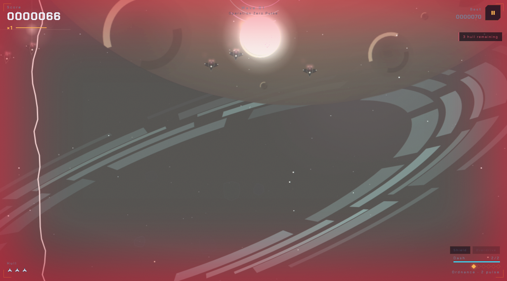

# EMBERFALL v4.29.0 — Orbital Intercept

A free arcade space shooter that runs in your browser. Something came through the Kuiper Gate, and you're the last ship between it and the orbital yard.

[](https://emberfall-game-two.vercel.app/)

**Play now: https://emberfall-game-two.vercel.app/**

[](https://github.com/FahadIbrahim93/emberfall/actions/workflows/ci.yml)
[](LICENSE)

<p align="center">
  
</p>

No install and no account needed. Art, music and sound are generated in code at runtime, so there are no asset files and no build step. After the first visit it plays offline.

## Features

- **Five ships** with different trade-offs, including WRAITH, the gate-recovered hull, and SERAPH with its continuous cutting lance.
- **Four modes:** Endless, Boss Rush, the Daily Gauntlet (one seed for everyone, each UTC day) and the Solar Tour (eight worlds, Mercury to the Kuiper Gate).
- **Scoring that pays for nerve:** graze bullets, chain combos, and pick a boon after each boss.
- **A hangar to come back to:** paints, sigils, hull mastery and kill plaques.
- **Accessibility options:** four colour palettes, reduced motion, left-handed and large touch layouts, high-visibility bullets.
- **Global and daily leaderboards.** Play as a guest with no account, or create one with your email and a password, confirm the email, and pick a callsign. Your Endless and Daily runs then post to the worldwide boards, which list registered pilots only. Sign in with X is planned.
- **Installable PWA** that works offline.

## Controls

| Action | Keys |
|---|---|
| Move | `WASD` or arrow keys |
| Fire | `Space` (or turn on autofire in Settings) |
| Dash | `Shift` |
| Pulse | `E` or `Q` |
| Pause | `P` or `Esc` |
| Mute / fullscreen | `M` / `F` |
| Touch | Drag anywhere to fly; firing is automatic. DASH and PULSE buttons sit bottom-right. |
| Gamepad | Detected automatically. |

## How it works

- The game is one `index.html` plus a handful of plain JavaScript modules in `js/`, drawn on a 2D canvas. No framework, no bundler.
- It's hosted as static files on Vercel. Every push to `main` deploys there automatically (a copy also goes to [GitHub Pages](https://fahadibrahim93.github.io/emberfall/)).
- Accounts and boards run on Supabase (project `rgmbexmodebegllahotc`). Row-level security is on, the tables accept no direct writes, and the only write path is two `SECURITY DEFINER` functions: `submit_score` and `set_callsign`. Scores are bounds-checked (1 to 10,000,000) and rate-limited (6 a minute, 300 a day per player). Only registered accounts can post, and the public views leave out anonymous sessions. Guests keep their scores on the device.
- Scores aren't replayed on a server, so a determined cheater could still post a fake score within bounds. Boss Rush, offline play and portal builds keep scores on the device.

More detail in [ARCHITECTURE.md](ARCHITECTURE.md) and [docs/LEADERBOARD-AND-ACCOUNTS.md](docs/LEADERBOARD-AND-ACCOUNTS.md).

## Local development

Open `index.html` in a browser, or serve it the way Vercel does so the service worker can install:

```bash
node tools/serve-static.mjs --port 8080   # static files only, same headers as vercel.json
```

A local copy talks to the same Supabase project as the live site (only the publishable key ships, in `js/cloud.js`). To try schema changes, apply `supabase/migrations/` to your own project and point `js/cloud.js` at it.

Tests need Node 22 or newer:

```bash
npm ci
bash check.sh             # syntax gate
node deadscan.js --check  # dead code and load order
npm run test:sim          # Vitest, packages/sim
npm run test:browser      # Playwright
npm test                  # sim + browser + in-game self-test
```

You can also run the self-test in the page with `index.html?selftest` (63 checks).

For web game portals, `npm run build:portal` writes `dist-portal/` and `dist-portal.zip`. Portal builds keep scores on the device. See [docs/DEPLOYMENT.md](docs/DEPLOYMENT.md).

## Tech stack

- Vanilla JavaScript, HTML5 canvas, Web Audio
- Service worker and web app manifest for offline play
- Vercel for hosting (GitHub Pages as a mirror)
- Supabase Auth and Postgres, via vendored supabase-js (`js/vendor/supabase.js`)
- Vitest and Playwright for tests, GitHub Actions for CI

## Docs

- [ARCHITECTURE.md](ARCHITECTURE.md): module load order, state ownership, invariants
- [docs/LEADERBOARD-AND-ACCOUNTS.md](docs/LEADERBOARD-AND-ACCOUNTS.md): accounts, boards and their limits
- [docs/DATABASE.md](docs/DATABASE.md): the Supabase schema
- [docs/DEPLOYMENT.md](docs/DEPLOYMENT.md): hosting, Supabase setup, portal builds
- [docs/ROADMAP.md](docs/ROADMAP.md): what's next
- [docs/adr/](docs/adr/): design decisions ([ADR 0004](docs/adr/0004-supabase-source-of-truth.md) is the current one)
- [CHANGELOG.md](CHANGELOG.md), [CONTRIBUTING.md](CONTRIBUTING.md), [SECURITY.md](SECURITY.md)
- [Press kit](docs/press-kit.md)

<!-- fun-curve:start (maintained by tools/fun-scoreboard.mjs — regenerate with --readme; do not hand-edit) -->
## The fun curve — the game, measured release over release

Every release, the repo's own instrumented play — the first-60-seconds audit (`tests/fun-audit.spec.js`) and the autopilot bot (`tests/fun-loop.spec.js`) — flies the game, and the numbers become a row here: how deep the bot flies, what it kills, how smoothly it runs. Best-wave counts the wave the bot REACHED in its 56-second headless flight — a depth probe, not a feat claim. Median-fps is environment-sensitive (CI's software renderer vs your GPU) — read the trend within a column, not the absolute.

Data: `docs/audit/fun-curve.json` (committed; one write-once row per version, written by `tools/fun-scoreboard.mjs` from the run's own artifacts). The raw artifacts are regenerated every run and stay git-ignored — only the distilled curve ships.

| Release | Date | Bot wave | Bot kills | Bot grazes | Combo × | Bot median fps | First-60s median fps |
|---|---|---|---|---|---|---|---|
| v4.29.0 "Pilot Card" | 2026-10-23 | 3 | 27 | 4 | ×2 | 45 | 38 |
| v4.28.0 "Guest Pass" | 2026-10-23 | 2 | 25 | 4 | ×3 | 34 | 21 |
| v4.27.0 "The Same Ladder" | 2026-10-19 | 2 | 23 | 1 | ×2 | 29 | 20 |
| v4.26.0 "The Open Gate" | 2026-09-30 | 2 | 20 | 3 | ×3 | 30 | 26 |
| v4.25.0 "The Listening Deck" | 2026-09-28 | 3 | 28 | 5 | ×2 | 47 | 45 |
| v4.24.0 "Signal" | 2026-09-28 | 2 | 15 | 1 | ×2 | 27 | 24 |
| v4.23.1 "The Fence" | 2026-09-28 | 2 | 17 | 2 | ×2 | 46 | 46 |
| v4.23.0 "Glasscockpit" | 2026-09-27 | 2 | 19 | 2 | ×2 | 27 | 21 |
| v4.22.2 "Open Surfaces" | 2026-09-27 | 2 | 20 | 6 | ×2 | 35 | 34 |
| v4.22.1 "The Recruiting Page" | 2026-09-27 | 3 | 27 | 4 | ×3 | 33 | 30 |
| v4.22.0 "The World Stage" | 2026-09-27 | 2 | 22 | 6 | ×2 | 27 | 21 |
| v4.21.2 "Always Reachable" | 2026-09-26 | 2 | 28 | 3 | ×3 | 25 | 23 |
| v4.21.1 "The Curve" | 2026-09-26 | 3 | 29 | 2 | ×2 | 39 | 23 |
| v4.21.0 "Proof of Play" | 2026-09-26 | 3 | 28 | 4 | ×2 | 46 | 48 |
| v4.20.0 "First Contact" | 2026-09-26 | 2 | 17 | 4 | ×2 | 24 | 48 |

<!-- fun-curve:end -->

## What's new in v4.29.0 — "Pilot Card"

- Sign in with a one-tap email code (or Google, once enabled), pick a ship-icon avatar, see your stats and rank, and switch the boards between Daily and All-time, now reachable from the title on every phone.
## What's new in v4.28.0 — "Guest Pass"

- Play as a guest with no account, or create an email account to post your Endless and Daily runs to the worldwide boards; the boards now list registered pilots only.

## What's new in v4.27.0 — "The Same Ladder"

- Boards, the `/pilot` page and the public mirror now all describe the same flight: the one that set the score. Ties share a rank. Older notes are in [CHANGELOG.md](CHANGELOG.md).

## License

MIT. See [LICENSE](LICENSE).

Made by Hope Theory. Fonts: [Michroma](https://fonts.google.com/specimen/Michroma) and [Chakra Petch](https://fonts.google.com/specimen/Chakra+Petch), both SIL Open Font License 1.1, self-hosted in `fonts/`.
