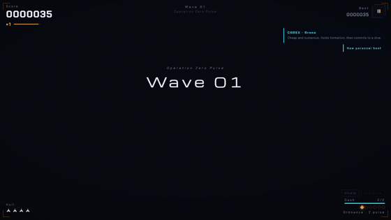

# EMBERFALL v4.27.0 — Orbital Intercept

**A free arcade space shooter that runs in your browser.** Something came through the Kuiper Gate, and you're the last ship between it and the orbital yard. Fly close to the fire, graze bullets for points, and see how deep you get.

**▶ Play now: https://emberfall-game-two.vercel.app/** (also on [GitHub Pages](https://fahadibrahim93.github.io/emberfall/))

[](https://github.com/FahadIbrahim93/emberfall/actions/workflows/ci.yml)
[](LICENSE)
[](https://fahadibrahim93.github.io/emberfall/docs/press-kit.html)

<p align="center">
  
</p>

No install and no accounts needed. The art, music and sound are all generated in code at runtime, so there are no asset files, no build step and no runtime npm packages. After the first visit it works offline.

## Controls

| | |
|---|---|
| Move | `WASD` or arrow keys |
| Fire | `Space` (or turn on autofire in Settings) |
| Dash | `Shift` |
| Pulse | `E` (or `Q`) |
| Pause | `P` or `Esc` |
| Mute / fullscreen | `M` / `F` |
| Touch | Drag anywhere to fly (it fires for you). DASH and PULSE buttons sit bottom-right. |
| Gamepad | Detected automatically. |

## Features

- **Five ships**, each with its own trade-offs, including SERAPH with a continuous cutting lance.
- **Four modes:** Endless, Boss Rush, the Daily Gauntlet (one seed for everyone, every day) and the Solar Tour (eight worlds, Mercury to the Kuiper Gate).
- **Scoring that rewards nerve:** graze bullets, chain combos and draft a boon after each boss.
- **A hangar to come back to:** paints, sigils, hull mastery and kill plaques.
- **Accessible by default:** four colour palettes, reduced-motion support, left-handed and large touch layouts, and a high-visibility bullets option.
- **Installable PWA** that plays offline.
- **Optional Command Deck server** for accounts, cloud saves, duels and shared leaderboards (see below).

**Leaderboards and pilot profiles:** the code is merged (#12, #14), but they are **not live yet**. They go live once the Command Deck server is deployed. Until then the game saves to your device.

<p align="center">
  
</p>

## Run it locally

Open `index.html` in a modern browser, or serve the folder so the service worker can install:

```bash
python -m http.server 8080      # or: npx serve .
# then open http://localhost:8080
```

To run the optional Command Deck (Node 22 or newer, no npm packages):

```bash
node server.js                  # http://localhost:8123, serves the game + API
```

If no deck answers, the game checks `/api/health` once and quietly stays local.

## Portal build

For web game portals:

```bash
npm run build:portal
```

This writes `dist-portal/` and `dist-portal.zip` (with `index.html` at the zip root, under 20 MB). It injects `window.EMBERFALL_PORTAL=true`, strips off-site links and fails with an error if the zip isn't created. You can also force portal mode on any copy with `?portal=1`. In portal mode, scores stay on the device.

## Tech stack

- **Game:** one `index.html` plus a few plain JavaScript modules in `js/`, drawn on a 2D canvas. No framework, no bundler.
- **Offline:** a service worker (`sw.js`) and a web app manifest.
- **Command Deck:** `server.js` on Node 22, using the built-in `node:sqlite`. No dependencies.
- **Public mirror:** a read-only Supabase copy of the public leaderboard facts ([ADR 0001](docs/adr/0001-sqlite-authoritative-supabase-mirror.md)).
- **Tests:** an in-game self-test (`index.html?selftest`, 77 checks), Vitest for the TypeScript sim in `packages/sim`, Playwright browser tests and a set of server drills in `tools/`.

More detail: [Architecture](ARCHITECTURE.md) · [Deployment](docs/DEPLOYMENT.md) · [Database](docs/DATABASE.md) · [Leaderboards & accounts](docs/LEADERBOARD-AND-ACCOUNTS.md) · [Roadmap](docs/ROADMAP.md).

<!-- fun-curve:start (maintained by tools/fun-scoreboard.mjs — regenerate with --readme; do not hand-edit) -->
## The fun curve — the game, measured release over release

Every release, the repo's own instrumented play — the first-60-seconds audit (`tests/fun-audit.spec.js`) and the autopilot bot (`tests/fun-loop.spec.js`) — flies the game, and the numbers become a row here: how deep the bot flies, what it kills, how smoothly it runs. Best-wave counts the wave the bot REACHED in its 56-second headless flight — a depth probe, not a feat claim. Median-fps is environment-sensitive (CI's software renderer vs your GPU) — read the trend within a column, not the absolute.

Data: `docs/audit/fun-curve.json` (committed; one write-once row per version, written by `tools/fun-scoreboard.mjs` from the run's own artifacts). The raw artifacts are regenerated every run and stay git-ignored — only the distilled curve ships.

| Release | Date | Bot wave | Bot kills | Bot grazes | Combo × | Bot median fps | First-60s median fps |
|---|---|---|---|---|---|---|---|
| v4.26.0 "The Open Gate" | 2026-09-30 | 2 | 20 | 3 | ×3 | 30 | 26 |
| v4.25.0 "The Listening Deck" | 2026-09-28 | 3 | 28 | 5 | ×2 | 47 | 45 |
| v4.24.0 "Signal" | 2026-09-28 | 2 | 15 | 1 | ×2 | 27 | 24 |
| v4.23.1 "The Fence" | 2026-09-28 | 2 | 17 | 2 | ×2 | 46 | 46 |
| v4.23.0 "Glasscockpit" | 2026-09-27 | 2 | 19 | 2 | ×2 | 27 | 21 |
| v4.22.2 "Open Surfaces" | 2026-09-27 | 2 | 20 | 6 | ×2 | 35 | 34 |
| v4.22.1 "The Recruiting Page" | 2026-09-27 | 3 | 27 | 4 | ×3 | 33 | 30 |
| v4.22.0 "The World Stage" | 2026-09-27 | 2 | 22 | 6 | ×2 | 27 | 21 |
| v4.21.2 "Always Reachable" | 2026-09-26 | 2 | 28 | 3 | ×3 | 25 | 23 |
| v4.21.1 "The Curve" | 2026-09-26 | 3 | 29 | 2 | ×2 | 39 | 23 |
| v4.21.0 "Proof of Play" | 2026-09-26 | 3 | 28 | 4 | ×2 | 46 | 48 |
| v4.20.0 "First Contact" | 2026-09-26 | 2 | 17 | 4 | ×2 | 24 | 48 |

<!-- fun-curve:end -->

## What's new in v4.27.0 — "The Same Ladder"

- Boards, the `/pilot` page and the public mirror now all describe the same flight: the one that set the score. Ties share a rank. Older release notes are in [CHANGELOG.md](CHANGELOG.md).

## Contributing

Bug reports, playtest notes and PRs are all welcome. Start with [CONTRIBUTING.md](CONTRIBUTING.md). The short version:

```bash
npm ci
bash check.sh                   # syntax gate
npm test                        # sim tests, browser tests, self-test (Node 22+)
```

Found a security issue? Please report it privately. See [SECURITY.md](SECURITY.md).

## License

MIT. See [LICENSE](LICENSE).

## Credits

Made by Hope Theory (AgentHope).
Fonts: [Michroma](https://fonts.google.com/specimen/Michroma) and [Chakra Petch](https://fonts.google.com/specimen/Chakra+Petch), both SIL Open Font License 1.1, self-hosted in `fonts/`.
